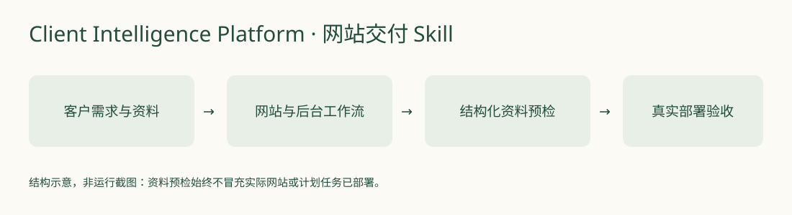

# 客户资讯平台定制 Skill

**把客户关注领域，推进成有来源、能维护的本地资讯网站。**



这是面向Codex等AI开发工具的工作流Skill，覆盖需求、免费优先选源、网站首次授权、独立后台采集、事件去重、日报发布与真实验收。自带Node.js标准库资料工具，用于初始化交付模板和检查结构；**它本身不是已部署的网站，也不会仅凭运行工具就创建后台计划任务。**

## 技术栈与前置条件

Markdown Skill、Node.js 20+、Node内置测试，无运行时第三方npm依赖。实际开发网站还需要支持Skill的AI开发环境，信息源授权与模型配置由客户自己完成。本仓库不提供可用服务密钥、不捆绑客户资料或现有FocusBrief数据库。

## 快速上手

```sh
git clone https://github.com/yangwei251003/client-intelligence-platform.git
cd client-intelligence-platform
node --test scripts/client-kit.test.mjs
```

将完整目录复制到AI工具实际支持的skills目录，使目录下直接有`SKILL.md`。例如用户目录的`.agents/skills/client-intelligence-platform/`；使用Codex自定义CODEX_HOME时遵循该环境的实际skills目录。

可以向Agent提出：

> 使用 $client-intelligence-platform，为一个示例制造企业设计本地资讯台，关注公开招投标和行业新品。先保留模型与来源未配置状态，使用合成数据做界面和后台结构验证；不要创建真实账户或付费服务。

普通命令行资料示例：先准备父目录，然后运行以下命令（目标资料目录必须尚不存在）：

```sh
node scripts/client-kit.mjs init --out ./example-client
node scripts/client-kit.mjs validate --dir ./example-client
node scripts/client-kit.mjs validate --dir ./example-client --ready
```

初次草稿的`--ready`应因缺少真实配置与验收证据而拒绝；这不是网站已运行的证明。初始化不覆盖已有目录。

## 目录与使用范围

- `SKILL.md`：从需求到网站与后台的分阶段工作流。
- `scripts/`：资料初始化、验证与确定性测试。
- `assets/`：无客户数据的配置、验收与交接模板。
- `references/`：选源、自动化、成本边界与交付规则。
- `agents/`：技能界面元数据。

网站中的来源连通、摘要质量、关闭浏览器后的定时运行与重启补跑，都必须在各自客户环境中实测。脚本只核对资料结构和证据引用，不验证证据内容真实，也不承诺外部服务永久免费。

## 状态、更新与许可

这是已交付并持续维护的v2工作流。2026-10-26整理完整公开源码与模板；Node既有19项测试及公开迁移CLI检查的结果见`docs/validation.md`。后续重点是适配不同平台与完善验收提示，未来信息源接入仍需现场核实。

自有代码/文档MIT；外部服务、官方文档及引用来源保留各自权利，不因本仓库开源而获得全文复制或商业再分发授权。
